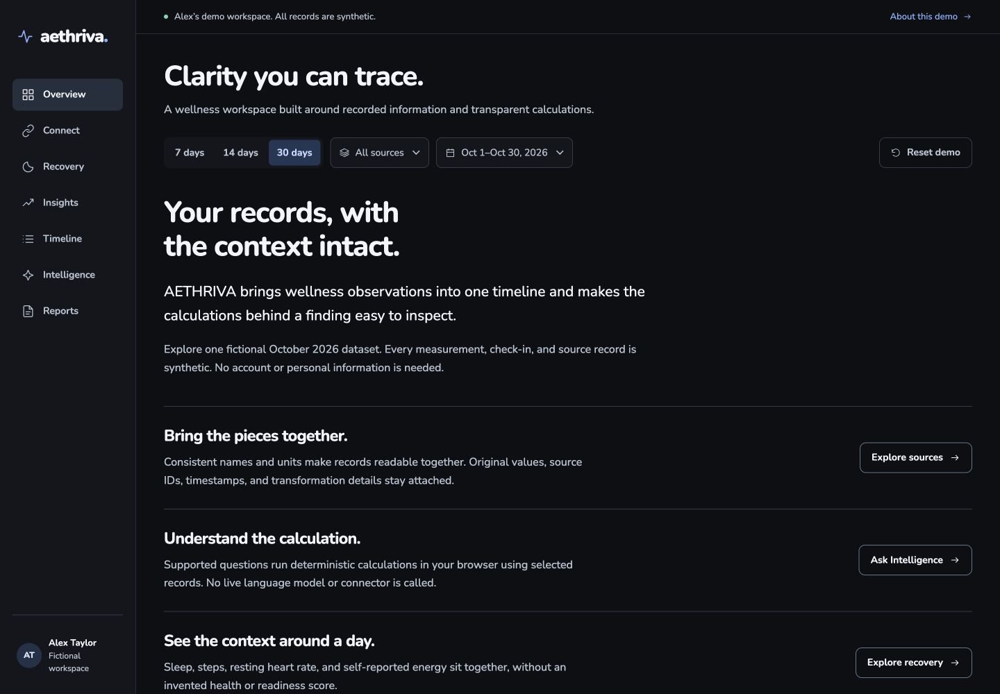

# AETHRIVA

Your health, connected and understood. A public, synthetic-data personal wellness intelligence workspace built for the Founders Inc. Nighthack.

Explore one fictional October 2026 history across sources, sleep, movement, resting heart rate, and self-reported energy. Ask a supported question and trace every quantitative finding to its exact observations and reproducible calculation.



**[Explore the public demo](https://aethriva-nighthack.tan9uj.chatgpt.site)**

## Run locally

Requires Node.js 24+. No package installation or API key is needed.

```sh
npm run dev
```

Open http://127.0.0.1:4173. Validate with `npm test` and `npm run check`.

## Product

- Overview with pastel measurement panels, a dated coverage calendar, and synchronized exploration.
- Connect with an honest synthetic source registry.
- Recovery with four aligned measurement histories, keyboard exploration, and a shared selected date.
- Insights with transparent period comparisons and associations.
- Timeline with values, units, Pacific timestamps, sources, and record IDs.
- Intelligence with five local, deterministic question types and complete evidence.
- Printable report and privacy/method limitations.

All health records are fictional. The analyst calculates locally; no live language model, health connector, account, or personal-data upload is involved. It does not diagnose, recommend treatment, or generate a readiness score.

## Structure

- `dist/` is the canonical buildless static application source.
- `dist/data/` holds the single fixture, pure analytics, and async service boundary.
- `dist/pages/` holds view renderers; shell, state, charts, and helpers are shared.
- `tests/` verifies fixture, calculations, evidence, and navigation-state behavior.
- `docs/` records implementation decisions, source provenance, and demo instructions.

The original private health apps are retained outside this checkout and excluded from GitHub and deployment. The chosen Carbon + Nunito preview supplied the visual grammar and chart interaction patterns. Nunito is self-hosted under its included SIL Open Font License.

## Team

[TanujBuilds](https://github.com/TanujBuilds) and [coderarush](https://github.com/coderarush). Existing Git history is preserved; new work uses the contributor's GitHub-linked author identity.

See [demo instructions](docs/DEMO.md), [implementation decisions](docs/IMPLEMENTATION.md), and [source map](docs/SOURCE_MAP.md).
